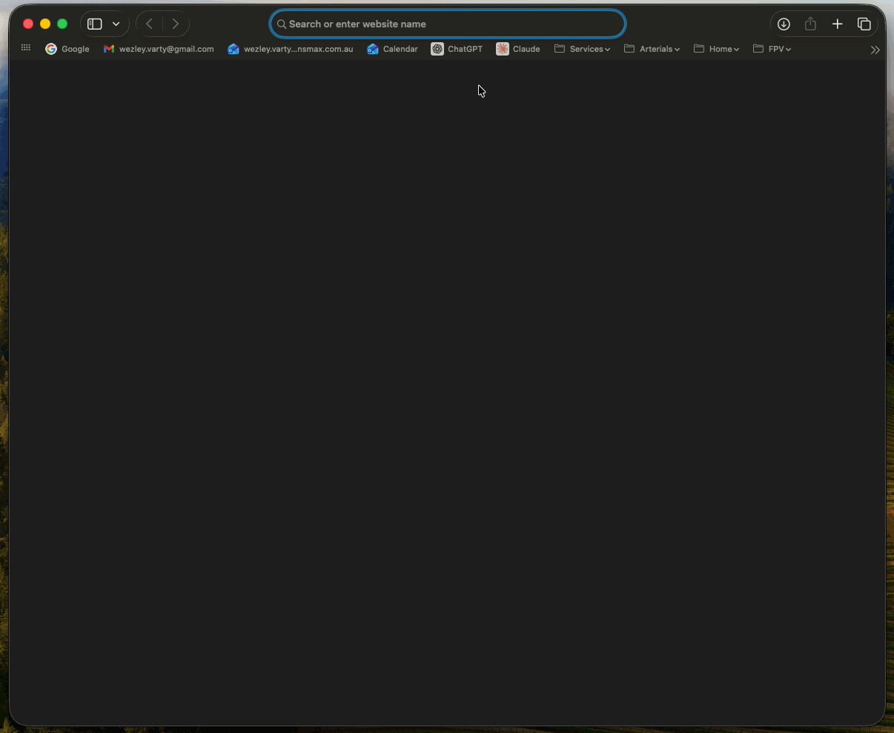

<h1 align="center">TitanLRS Backpack</h1>

  
  
  

**TitanLRS Backpack** is Titan Dynamics' fork of the [ExpressLRS Backpack](https://github.com/ExpressLRS/Backpack), built to pair with [TitanLRS](https://github.com/Titan-Dynamics/TitanLRS) TX modules. It can be flashed using the [TitanLRS Web Flasher](https://titan-dynamics.github.io/TitanLRS-Web-Flasher/). It keeps everything the upstream Backpack does (ESP-NOW control of VRx modules, head tracking, timers, MAVLink over WiFi) and adds a full web-based Lua configurator, so you can set up your TX and RX from any phone or laptop browser.

## What is a Backpack?

Many TX modules include a second, small ESP chip alongside the main radio. That chip is the "TX Backpack". It talks to other ESP-based FPV devices over ESP-NOW, supplies MAVLink telemetry via WiFi, and hosts a web interface for the module.

# TitanLRS Backpack adds:

## Lua from your browser

ELRS TX modules are normally configured with the Lua script on an EdgeTX handset. That's fine when the module is paired with an EdgeTX handset, but if it's not, or you just don't have the radio handy, there's no screen to configure it from.

The TitanLRS Backpack hosts the whole Lua parameter tree on its WiFi web page. Connect to the backpack's access point, open the **Parameters** tab, and it scans for the TX module and any linked receivers automatically. Pick a device on the left and browse its folders and settings on the right, just like the Lua script. Changes are sent as CRSF frames over the backpack's UART and apply immediately.

- **TX and RX config:** set up the TX module and the connected receiver (the equivalent of "Other Devices" in the Lua script).
- **Live link status:** RX connected state, plus good/bad packet counts, refreshed in real time.
- **Same prompts as the Lua:** commands that ask for confirmation in the Lua script get the same confirm popup in the browser.

This needs a matching TitanLRS firmware on the TX module, see [Titan-Dynamics/TitanLRS](https://github.com/Titan-Dynamics/TitanLRS/).

## Name your access point

Fly more than one TX and they all show up as the same "ExpressLRS TX Backpack" network. From the **Network** tab you can now set a custom SSID and WiFi password for the TX Backpack's access point, so each module is easy to pick out.

The ability to define a custom password for the backpack access point also means you aren't constrained to the default password, offering better data security.

## WiFi and MAVLink out of the box

The TX Backpack now starts WiFi on boot and defaults to MAVLink telemetry over WiFi. Power up the TX, join its access point, and your GCS picks up MAVLink over UDP with no setup in the LUA first.

## Refreshed web UI

The webUI for backpack has been rebuilt in the Titan Dynamics theme, to match the [TitanLRS](https://github.com/Titan-Dynamics/TitanLRS).

## Compatibility

Web Lua configuration needs [TitanLRS](https://github.com/Titan-Dynamics/TitanLRS) firmware on the TX module.

## Upstream

TitanLRS Backpack is built on the [ExpressLRS Backpack](https://github.com/ExpressLRS/Backpack), developed and maintained by ExpressLRS LLC.

- Website and docs: <https://www.expresslrs.org/>
- Repository: <https://github.com/ExpressLRS/Backpack>
- Wiki: <https://github.com/ExpressLRS/Backpack/wiki>
- Community: [Discord](https://discord.gg/expresslrs)
- Support the project: [Open Collective](https://opencollective.com/expresslrs)

TitanLRS Backpack is open source under the same license as the ExpressLRS Backpack, the GNU GPL v3. See [LICENSE](LICENSE).
